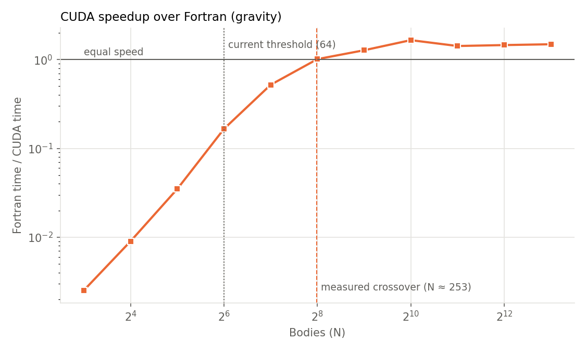

# High-Performance Physics Engine

[](https://github.com/StevenKight/Physics-Engine/actions/workflows/pre-commit.yml)
[](https://github.com/StevenKight/Physics-Engine/actions/workflows/build-test.yml)
[](https://github.com/StevenKight/Physics-Engine/actions/workflows/cuda-compile.yml)

A research project building a physics simulation engine using C/C++, Fortran, and CUDA. The goal is N-body gravity and convex collision simulation with computation routed to whatever hardware makes the most sense for the job.

The short version: CUDA handles the big parallel workloads, Fortran handles small tight-loop numerical operations where it genuinely outperforms the alternatives, and C++ manages everything in between. Getting all three to compile together through CMake was its own adventure.

---

## Why This Stack

CUDA for GPU-accelerated parallel work is a straightforward choice. The Fortran decision gets more questions — the reasoning is that for small, tight numerical loops, Fortran's array handling and compiler optimizations are hard to beat and don't carry the overhead of GPU dispatch. Rather than forcing everything onto the GPU, the idea is to use the right tool for the scale of the problem.

C/C++ ties it all together and handles the core simulation logic.

---

## Current State

- CMake build system configured for all three languages compiling together; `Makefile` wraps common workflows (`build`, `test`, `package`, `clean`)
- Complete matrix operation suite (addition, subtraction, multiplication, scalar operations, element-wise division, Hadamard product, power, row/column summing) implemented in both CUDA and Fortran backends
- `Vec3` 3D vector type and `PhysicsObject` model with Velocity Verlet integration (`object_update_position` / `object_update_velocity`)
- Newtonian N-body gravity with adaptive CPU/GPU routing (Fortran for ≤256 bodies, CUDA above that threshold)
- Two-phase collision detection: octree broad phase (AABB overlap) + SAT narrow phase (convex meshes; parallelised with OpenMP)
- Inelastic collision response with configurable coefficient of restitution applied along the collision normal
- Top-level `sim_run` simulation loop running collision detection and response, then a Velocity Verlet step with gravity evaluated at the updated positions, each tick
- Python ctypes interface (`interface/nbody.py`) for driving simulations from Python; `PhysicsObject.set_mesh()` attaches convex geometry for collision detection
- Blender addon (`blender/`) integrating the simulation into Blender's physics system — convex hulls are extracted automatically from object meshes and baked N-body motion is written as keyframes
- Unit test suite covering matrix operations, gravity, AABB helpers, collision detection, inelastic response, and Velocity Verlet integration
- Analytic validation and backend benchmarks (see [Results](#results))

The [Wiki](https://github.com/StevenKight/Physics-Engine/wiki) has derivations and math notes as they get worked out.

---

## Results

All numbers below come from scripts in this repo and the files they write. Measured on an **NVIDIA RTX 3070** (driver 580.196.07, CUDA 12.1) and **AMD Ryzen 7 5800X**, GCC/gfortran 14.2, CMake 3.30, Linux 6.11, Release build. Full details: [benchmarks/ENVIRONMENT.md](benchmarks/ENVIRONMENT.md).

### Validation

Each case runs through `sim_run` and is compared with the analytic answer ([validation/RESULTS.md](validation/RESULTS.md), also run by `make test`):

| Case | Metric | Tolerance | Measured | Result |
|---|---|---|---|---|
| Free flight | position error after 100 s (m) | 1.0e-09 | 4.307e-11 | pass |
| Free flight | velocity change (m/s) | 1.0e-12 | 0.000e+00 | pass |
| Kepler orbit (e=0.5) | period relative error | 1.0e-04 | 4.064e-05 | pass |
| Kepler orbit (e=0.5) | max energy drift over 10 orbits | 1.0e-04 | 2.682e-05 | pass |
| Kepler orbit (e=0.5) | max angular momentum drift over 10 orbits | 1.0e-12 | 1.196e-14 | pass |
| Verlet convergence | observed order - 2 | 1.0e-01 | -4.064e-04 | pass |
| Inelastic collision | momentum change (relative) | 1.0e-12 | 0.000e+00 | pass |
| Inelastic collision | v_rel_after / v_rel_before + e | 1.0e-06 | 1.208e-13 | pass |

Halving the time step cuts the orbit error by 3.98x, 4.00x and 4.00x, so the integrator is second order as Velocity Verlet should be. Pendulum and projectile cases are left out because the engine has no external or constraint forces.

### Fortran vs CUDA gravity



Each backend is forced explicitly and timed over 10 runs after a warm-up ([benchmarks/CROSSOVER.md](benchmarks/CROSSOVER.md)):

- CUDA first beats Fortran at **N = 256** and keeps winning at every larger N measured. The crossover is between 128 and 256 bodies (about 251 by log-log interpolation). At 256 the two are within each other's run-to-run spread (CUDA 10.1 ms, Fortran 10.3 ms), and an earlier run had CUDA slightly slower there, so treat 256 as the break-even point rather than a clear win.
- The old 64-body threshold was **too low**: at N = 128 the router picked CUDA and took 4.9 ms where Fortran takes 2.6 ms. The threshold is now 256, so the router uses Fortran up to the break-even point.
- The best speedup is **1.59x at N = 1024** (RTX 3070 vs one Ryzen 7 5800X core; driver 580.196.07, CUDA 12.1, GCC 14.2, Linux 6.11).
- The speedup stays small because the CUDA path copies every intermediate matrix to and from the GPU. Profiling one call at N = 4096 shows about 2.1 s in `cudaMemcpy` against 0.09 s in kernels, and the kernels themselves are limited by FP64 throughput ([benchmarks/PROFILE.md](benchmarks/PROFILE.md)).
- Gravity uses about 12 N x N matrices at its peak, so runs stop at N = 8192; 16384 would need about 26 GB.

More plots: [gravity scaling](benchmarks/plots/gravity_scaling.png), [full simulation tick, 1 vs 16 threads](benchmarks/plots/sim_scaling.png). Raw data: [benchmarks/results/](benchmarks/results/).

### Reproducing

```bash
./benchmarks/run.sh                 # builds in Release, records the environment, writes a new CSV (~40 min)
python3 benchmarks/crossover.py     # crossover table from the newest CSV
python3 benchmarks/plot.py          # plots from the newest CSV
./benchmarks/profile.sh             # Nsight Systems and Compute profile of one gravity call
OMP_NUM_THREADS=1 ./build/validation/validate > validation/RESULTS.md
```

---

## Build

### Prerequisites

- NVIDIA GPU and the [CUDA Toolkit](https://developer.nvidia.com/cuda-toolkit)
- Fortran compiler (GNU Fortran or Intel Fortran)
- [CMake](https://cmake.org/download/) 3.18+
- CuBLAS (optional, for optimized matrix operations)

### Instructions

```bash
git clone https://github.com/StevenKight/Physics-Engine.git
cd Physics-Engine
make
```

### Running Tests

```bash
make test
```

---

## Blender Addon

The `blender/` directory contains a Blender addon that exposes the simulation through the Physics properties panel, allowing objects to be tagged as N-Body participants with their mass and initial velocity set directly in the UI.

### Prerequisites

- Blender 4.2 or later
- The project cloned and built locally (see [Build](#build) above)

### Installation

**1. Build the addon zip**

From the project root:

```bash
make package
```

**2. Install in Blender**

- Open **Edit > Preferences > Get Extensions**
- Click the dropdown arrow (top right) and select **Install from Disk**
- Select `physics_engine.zip` from the project root

**3. Configure the project root**

- Go to **Edit > Preferences > Add-ons** and find **Physics Engine**
- Set **Project Root** to the absolute path of this repository (e.g. `/home/user/Physics-Engine`)
- This allows the addon to locate `interface/nbody.py` and the compiled library at runtime

### Usage

With the addon enabled, select any object and open the **Physics** tab in the Properties panel. An **N-Body** button will appear alongside the built-in physics types. Enabling it marks the object as an N-Body participant and exposes its **Mass** and **Initial Velocity** for use in simulation.

---

## Sample Scene

Two sample scenes are included. Open either in Blender (with the addon installed and configured) and hit **Run Simulation**.

**`Sample - Solar System.blend`** — Newtonian N-body gravity with planetary orbits. Planet models by **FyorDev** on SketchFab — [Solar System (Real Scale, 2k Textures)](https://sketchfab.com/3d-models/solar-system-real-scale-2k-textures-febde2b6e3f64b06965620fd3ddc97c2), used for demonstration purposes.

**`Sample - Collisions.blend`** — Demonstrates inelastic collision detection and response between objects with convex mesh geometry.

---

## Roadmap

- Optimized matrix operations replacing naive implementations
- Rotational dynamics (orientation, angular velocity, torque)
- Benchmarking against existing engines
- Soft-body dynamics and constraint systems
- Additional Rendering pipeline integrations

---

## License

Licensed under the [GNU General Public License v3.0](./LICENSE). Derivative works must carry the same license.

---

## Contributing

Not open for contributions yet. If you want to discuss the project or have ideas, open an issue or reach out directly. See [CONTRIBUTING.md](./CONTRIBUTING.md) for more details.
